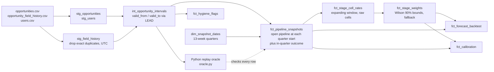

# stageweights

[](https://github.com/SlateGitOrg/stageweights/actions/workflows/ci.yml)


stageweights replaces hand-typed CRM stage probabilities with weights learned from the CRM's own change log. A dbt-duckdb project replays every opportunity's field history into validity intervals, rebuilds the open pipeline as it stood on the first day of each 13-week fiscal quarter, and estimates win-in-quarter rates by stage and close-date push count using only quarters that had already ended. Those weights are backtested out of sample against the CRM default probabilities and the probabilities reps typed in. A pure-Python replay of the change log cross-checks every reconstructed snapshot row. All data is synthetic and seeded.

## The problem

A mid-market payroll-services sales team forecasts each quarter by multiplying open pipeline by stage probabilities configured in the CRM years ago (Proposal = 60%). Nobody can check them. The opportunity table holds only each deal's current stage, so a conversion rate computed from it credits lost deals to the stage they died in and ignores how the pipeline looked on the day the forecast was made. Deals whose close date has been pushed repeatedly keep their stage probability and inflate the commit.

The change log (`opportunity_field_history`) does contain the answer: it records every change to stage, amount, close date and rep probability with a timestamp. Replaying it gives the pipeline at any past instant, together with what happened next, which is exactly what is needed to measure how often a deal at a given stage actually wins within the quarter.

## How it works



1. `stageweights generate` writes three CSVs from a seeded generator: 18 reps in three segments, 2,400 opportunities created over FY2023 Q1 to FY2025 Q4, and about 20,500 field-history rows including 2% exact duplicates. Deals advance weekly through an absorbing Markov chain; 25% are "slippers" that advance at 0.4x the rate, and a deal whose close date has been pushed three or more times additionally advances at 0.45x (a stall factor added to the generator, see Design decisions).
2. `stageweights build` runs `dbt build` in-process. Staging removes exact duplicate history rows on the raw text and casts timestamps (written with local UTC offsets) to UTC. `int_opportunity_intervals` seeds each field from the creation values and closes each interval with `LEAD` over the ordered changes.
3. `fct_pipeline_snapshots` range-joins the intervals to `dim_snapshot_dates` (quarters of exactly 91 days from Monday 2 January 2023, snapshot at 00:00 UTC). A deal enters a snapshot only if it had been created and was in an open stage at that instant. The row carries deal age, days in stage, close-date push count so far, and the outcome at the quarter end: `won`, `lost`, `slipped` (still open, close date inside the quarter) or `open`. Deals created during a quarter are reported in `fct_quarter_creations` and never enter a snapshot.
4. `fct_stage_cell_rates` and `fct_stage_weights` estimate, for each forecast quarter, the win-in-quarter rate of every stage x push bucket (0, 1-2, 3+) from snapshot rows of quarters that ended on or before the forecast quarter began. A cell with fewer than 30 rows falls back to the stage-only rate, and a stage with fewer than 30 rows keeps the CRM default.
5. `fct_forecast_backtest` and `fct_calibration` score the CRM default, the rep-entered probability and the learned weight against what the same deals did. `fct_hygiene_flags` lists data-quality flags per opportunity.

## Quick start

```bash
python3 -m venv .venv
.venv/bin/pip install -e ".[dev]"

.venv/bin/stageweights generate --seed 7 --out data
.venv/bin/stageweights build --data data --work work
.venv/bin/stageweights backtest --data data --work work
.venv/bin/stageweights calibration --data data --work work
.venv/bin/stageweights hygiene --data data --work work --top 20

.venv/bin/python -m pytest -q
```

Requires Python 3.11+ and dbt-core / dbt-duckdb 1.10 or newer (below 2): the schema tests use the `arguments:` key and the runner calls dbt's in-process API.

`generate --homogeneous` writes the exact-recovery dataset (6,000 deals, one segment, no slippers or rep effects) and `generate --no-enterprise-drop` switches off the planted FY2025 Q3 change. `build` creates `work/<dataset>/target/stageweights.duckdb`, one DuckDB file and one dbt target directory per dataset, and needs no network access. The dbt project lives in `dbt/`, so the CLI runs from a source checkout.

## Example output

Produced by the commands above on the seed-7 dataset.

```text
$ stageweights generate --seed 7 --out data
Wrote 2,400 opportunities and 20,522 history rows (377 exact duplicates) to data

$ stageweights build --data data --work work
dbt build passed: 13 models, 59 tests. DuckDB file: work/data/target/stageweights.duckdb

$ stageweights backtest --data data --work work
              Closed-won forecast made at each quarter start vs what those deals closed for
┏━━━━━━━━━━━┳━━━━━━━━━━━━┳━━━━━━━━━━━━━┳━━━━━━━━━━━━━┳━━━━━━━━━━━━┳━━━━━━━━━━━━━┳━━━━━━━━━┳━━━━━━━━━━━━━┓
┃ Quarter   ┃     Actual ┃ CRM default ┃ Rep entered ┃    Learned ┃ APE default ┃ APE rep ┃ APE learned ┃
┡━━━━━━━━━━━╇━━━━━━━━━━━━╇━━━━━━━━━━━━━╇━━━━━━━━━━━━━╇━━━━━━━━━━━━╇━━━━━━━━━━━━━╇━━━━━━━━━╇━━━━━━━━━━━━━┩
│ FY2024 Q1 │ $3,215,600 │  $8,764,680 │  $7,521,985 │ $5,170,464 │      172.6% │  133.9% │       60.8% │
│ FY2024 Q2 │ $5,721,700 │  $9,262,870 │  $8,760,745 │ $4,953,070 │       61.9% │   53.1% │       13.4% │
│ FY2024 Q3 │ $2,458,600 │  $7,123,210 │  $6,823,620 │ $3,330,908 │      189.7% │  177.5% │       35.5% │
│ FY2024 Q4 │ $3,170,600 │  $7,465,220 │  $6,856,115 │ $3,391,453 │      135.5% │  116.2% │        7.0% │
│ FY2025 Q1 │ $2,624,700 │  $8,529,280 │  $7,976,770 │ $3,862,380 │      225.0% │  203.9% │       47.2% │
│ FY2025 Q2 │ $3,227,300 │ $10,055,460 │  $9,118,595 │ $4,819,336 │      211.6% │  182.5% │       49.3% │
│ FY2025 Q3 │ $3,005,100 │ $10,043,220 │  $9,016,655 │ $4,876,023 │      234.2% │  200.0% │       62.3% │
│ FY2025 Q4 │ $3,129,800 │ $10,430,190 │  $9,791,810 │ $4,753,219 │      233.3% │  212.9% │       51.9% │
├───────────┼────────────┼─────────────┼─────────────┼────────────┼─────────────┼─────────┼─────────────┤
│ MAPE      │            │             │             │            │      183.0% │  160.0% │       40.9% │
│ Mean bias │            │             │             │            │     +183.0% │ +160.0% │      +37.6% │
└───────────┴────────────┴─────────────┴─────────────┴────────────┴─────────────┴─────────┴─────────────┘
            Learned stage weights for FY2025 Q4 (win within the quarter)
┏━━━━━━━━━━━━━━━┳━━━━━━━━━━━━━┳━━━━━━━━━━━━━┳━━━━━━━━━━━━┳━━━━━━━━━━━━┳━━━━━━━━━━━━━┓
┃ Stage         ┃ CRM default ┃    0 pushes ┃ 1-2 pushes ┃  3+ pushes ┃  Stage only ┃
┡━━━━━━━━━━━━━━━╇━━━━━━━━━━━━━╇━━━━━━━━━━━━━╇━━━━━━━━━━━━╇━━━━━━━━━━━━╇━━━━━━━━━━━━━┩
│ Prospecting   │        0.10 │ 0.026 n=313 │ 0.025s n=6 │ 0.025s n=4 │ 0.025 n=323 │
│ Discovery     │        0.20 │ 0.065 n=620 │ 0.083 n=36 │ 0.026 n=38 │ 0.063 n=694 │
│ Solution      │        0.40 │ 0.109 n=522 │ 0.000 n=35 │ 0.000 n=47 │ 0.094 n=604 │
│ Proposal      │        0.60 │ 0.295 n=376 │ 0.194 n=72 │ 0.015 n=65 │ 0.246 n=513 │
│ Negotiation   │        0.80 │ 0.535 n=213 │ 0.446 n=65 │ 0.211 n=71 │ 0.453 n=349 │
│ Contract Sent │        0.90 │  0.875 n=72 │ 0.762 n=42 │ 0.579 n=38 │ 0.770 n=152 │
└───────────────┴─────────────┴─────────────┴────────────┴────────────┴─────────────┘
s = fell back to the stage-only rate (cell under 30 rows); d = CRM default kept

$ stageweights calibration --data data --work work
                 Calibration over the scored quarters (deal level)
┏━━━━━━━━━━━━━┳━━━━━━━┳━━━━━━━━━━━━━━━━┳━━━━━━━━━━┳━━━━━━━━━━━━━━━━━━━━━━┳━━━━━━━━┓
┃ Method      ┃ Deals ┃ Mean predicted ┃ Realised ┃ Predicted - realised ┃  Brier ┃
┡━━━━━━━━━━━━━╇━━━━━━━╇━━━━━━━━━━━━━━━━╇━━━━━━━━━━╇━━━━━━━━━━━━━━━━━━━━━━╇━━━━━━━━┩
│ learned     │ 2,280 │          0.210 │    0.189 │               +0.021 │ 0.1169 │
│ crm_default │ 2,280 │          0.441 │    0.189 │               +0.251 │ 0.1928 │
│ rep_entered │ 2,280 │          0.417 │    0.189 │               +0.228 │ 0.1963 │
└─────────────┴───────┴────────────────┴──────────┴──────────────────────┴────────┘

$ stageweights hygiene --data data --work work --top 10
                                           Top 10 hygiene flags as of 2025-09-29
┏━━━━━━━━━━━━━┳━━━━━━━━━━━━┳━━━━━━━━━━━━━━━┳━━━━━━┳━━━━━━━━━━┳━━━━━━━━┳━━━━━━━━━━━┳━━━━━━━━━━━━━━━━━━━━━━━━━━━━━━━━━━━━━━━━┓
┃ Opportunity ┃ Segment    ┃ Stage         ┃ Open ┃    Value ┃ Pushes ┃ Idle days ┃ Flags                                  ┃
┡━━━━━━━━━━━━━╇━━━━━━━━━━━━╇━━━━━━━━━━━━━━━╇━━━━━━╇━━━━━━━━━━╇━━━━━━━━╇━━━━━━━━━━━╇━━━━━━━━━━━━━━━━━━━━━━━━━━━━━━━━━━━━━━━━┩
│ OPP-01916   │ enterprise │ Negotiation   │ yes  │ $315,300 │     10 │        35 │ 3+ pushes, regression, close date past │
│ OPP-02209   │ mid_market │ Discovery     │ yes  │  $35,000 │     10 │        28 │ 3+ pushes, regression, close date past │
│ OPP-00911   │ smb        │ Proposal      │ yes  │  $23,400 │      3 │        35 │ 3+ pushes, regression, close date past │
│ OPP-01148   │ smb        │ Negotiation   │ yes  │  $19,200 │     10 │        28 │ 3+ pushes, regression, close date past │
│ OPP-00529   │ enterprise │ Solution      │ yes  │ $958,700 │      4 │         7 │ 3+ pushes, regression                  │
│ OPP-00751   │ enterprise │ Discovery     │ yes  │ $134,300 │      4 │        21 │ 3+ pushes, regression                  │
│ OPP-02129   │ enterprise │ Proposal      │ yes  │ $122,700 │     12 │        14 │ 3+ pushes, regression                  │
│ OPP-01030   │ enterprise │ Negotiation   │ yes  │  $96,300 │      2 │        35 │ regression, close date past            │
│ OPP-00784   │ enterprise │ Discovery     │ yes  │  $90,400 │      3 │         7 │ 3+ pushes, regression                  │
│ OPP-01482   │ mid_market │ Contract Sent │ yes  │  $73,800 │      0 │         7 │ close date past, stage jump            │
└─────────────┴────────────┴───────────────┴──────┴──────────┴────────┴───────────┴────────────────────────────────────────┘
```

The hygiene list ranks deals open at the snapshot first, then by flag count and pipeline value; closed deals follow only if fewer than N open deals are flagged. Cell weights are raw rates with no smoothing, so a cell can be exactly 0.000 (Solution, 1-2 pushes above); the Wilson 90% bounds in `fct_stage_weights` show how little a small cell supports.

The learned forecast has the lowest error in every quarter and a mean absolute percentage error of 40.9%, against 183.0% for the CRM defaults and 160.0% for rep-entered probabilities. It still runs high (mean bias +37.6%). Part of that is the planted FY2025 Q3 drop in enterprise Negotiation, which no weight learned from earlier quarters can see (and the pooled weights dilute it: the FY2025 Q4 stage-level Negotiation rate is about 0.453 with the change against 0.456 without, so the effect is shown in enterprise Negotiation snapshot win rates rather than in the weight table); part is that the weights have no segment dimension, while the largest deals are enterprise deals that win less often. Reps' own probabilities are only modestly better than the defaults: two reps add 25 points and the rest add noise around the stage default.

## Design decisions

- **Intervals rather than daily snapshots.** Replaying the log into `[valid_from, valid_to)` intervals stores each change once and answers "state at instant t" with a range join, so any snapshot date can be added without re-running a history job. The cost is that correctness rests on the intervals tiling time exactly; two singular tests assert no overlap, no gap, exactly one open interval per field, and that the last interval equals the value the opportunity table holds today.
- **A push is a later close date on a deal that stays open.** When a deal is won or lost late, the CRM resets the close date to that day, which can be later than the old one. Counting that as a push would charge won deals for a slip they did not have, so the interval model only marks a close-date change as a push when the stage in force at that instant is still open.
- **The training window is defined by quarter end, not quarter index.** A snapshot quarter contributes to a forecast quarter only if its end date is on or before the forecast quarter's first day, so the outcome it records is known at that time. A singular test and a Python recomputation both check the row counts, and a test regenerates the data with the planted late change switched off and requires every weight up to FY2025 Q3 to be identical.
- **Weights are by stage and push bucket only.** This keeps cells large enough to estimate (the 30-row threshold already pushes thin cells to the stage rate) at the price of ignoring segment. In the exact-recovery mode there is a single segment and the stage rates land within 0.04 of the generator's 13-step absorption probability; in full mode the pooled rate is a mixture, and dollar-weighted forecasts are biased high because large enterprise deals convert less often.
- **Hygiene is judged as of the latest snapshot date.** Flags use only history up to that instant, for every opportunity that existed then, so the report is something that could have been run on that day. Deals won or lost afterwards do not change it; the cost is that it says nothing about the final quarter's events.
- **The push effect is partly built into the generator.** The slipper class alone does not make deals with 3+ pushes win at under half the rate of unpushed deals in Negotiation: even a Negotiation bucket made only of slippers wins about 0.2 within the quarter against 0.55 for normal deals, and the 3+ bucket is a mixture, so the measured ratio stayed near 0.7-0.8 in the generator variants tried. The generator therefore also slows deals after their third push (`STALL_PUSHES = 3`, `STALL_FACTOR = 0.45`, full mode only; the homogeneous mode has neither). This drives the 3+ push cells in the weight table, so the recovered push-bucket gap is by construction; the learning code does not know about it. The generator exposes the base-chain `true_win_in_quarter` only, which excludes slippers and the stall.
- **Each simulated deal has its own random stream.** All of a deal's draws are made before any pattern switch is read, so turning the FY2025 Q3 change off alters only what affected deals do after that date. The price is that the generator is a per-deal Python loop rather than a vectorised simulation, which is fast enough at this size.

## Testing

```bash
.venv/bin/python -m pytest -q
```

57 tests run offline in under half a minute. A session-scoped fixture generates each dataset and runs `dbt build` once (full, full with the late change off, homogeneous, and full with duplicates pre-removed); the build runs all 59 dbt schema and singular tests.

- The SQL snapshot rows (stage, amount, close date, rep probability, push count) equal the Python replay oracle exactly for every opportunity at every quarter start, and the row counts equal the oracle's count of open deals.
- Intervals tile time, and a build from history with the duplicates already removed produces identical intervals.
- In homogeneous mode the learned stage rates for the last forecast quarter are within 0.04 of `true_win_in_quarter`, and the Wilson bounds cover the truth for at least 80% of cells.
- In full mode the learned Proposal weight is at least 0.15 below 0.60, and the raw 3+ push cell rate is under half the 0-push rate for Proposal and Negotiation.
- Backtest and calibration: learned MAPE and Brier score are the lowest, the CRM default's mean bias is at least +20%, and the actual and forecast amounts are recomputed independently from the oracle.
- Hygiene: every planted Discovery-to-Contract-Sent jump is flagged (and nothing else is), the count of open deals with 3+ pushes equals the generator's, and the other flags follow from the raw history.

## Project layout

```text
dbt/
  dbt_project.yml, profiles.yml      profile points at a DuckDB file under target/
  macros/wilson.sql                  Wilson score bounds
  models/staging/                    sources (CSV via external_location), stg_* models
  models/intermediate/               int_opportunity_intervals
  models/marts/                      dim_*, fct_* models and schema tests
  tests/                             singular SQL tests
src/stageweights/
  synth.py                           seeded generator, true_win_in_quarter
  oracle.py                          pure-Python event replay
  runner.py                          in-process dbt build, one target and DuckDB file per dataset
  reports.py, cli.py                 mart readers and the typer CLI
  fiscal.py                          13-week fiscal calendar
tests/                               pytest suite
```

## License

MIT. See `LICENSE`.
